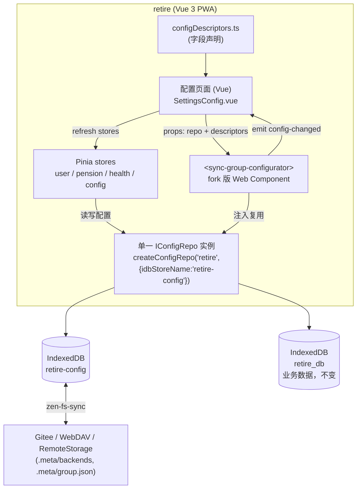

# retire 接入 zen-fs-config-ui 设计方案

> 状态：设计稿（未实施，未修改任何代码）
> 日期：2026-11-22
> 范围：retire 配置层升级 + 配置界面通用化

---

## 1. 结论摘要

retire 当前**已经**用 zen-fs-config 0.5.18 保存配置（`src/config/configRepo.ts:29,292-296`，`idbStoreName:'retire-config'`），配置经 `repo.setConfig/getConfig` 落 IndexedDB，并同步到 Gitee / WebDAV / RemoteStorage。因此本次不是"首次接入存储"，而是三件事：

1. **升级**：zen-fs-config `^0.5.18` → **锁定 0.8.0**（tag `7363006`；不要装 HEAD 的 0.9.0-dev，它有"停写 group-type 标记"的破坏性变更）。
2. **fork UI**：`zen-fs-config-ui v0.4.1` 是 npm 发布的 Web Component 库，但它**只能配置同步拓扑**（后端/数据组），且**会自己另建 repo 和 IndexedDB**。必须 fork 补两项能力：**注入宿主已有 repo**、**编辑业务配置值**。
3. **接管界面**：用一个配置页面替代现有分散的配置表单，覆盖 ①同步拓扑 ②配置云同步后端 ③业务数据云同步后端 ④业务配置值（`/user`、`/pension`、`/health`）。

**硬约束（方案成立的前提）**：retire 与 UI 必须共用**同一个 repo 实例、同一个 IndexedDB `retire-config`**。任何让 UI 自行 `connect(appId)` 的做法都不能接受。

---

## 2. 事实基线（设计依据）

| 主题 | 事实 | 证据 |
|---|---|---|
| retire 存储 | APP_ID=`retire`，`idbStoreName:'retire-config'`；本地主库名与 UI 默认名 `zen-fs-config-config-retire` **不同** | `retire/src/config/configRepo.ts:29,292-296`；`zen-fs-config@0.8.0 src/folder-backend.ts:187` |
| 配置路径 | `/user`、`/pension`、`/health`、`/sync`、`/data-sync`，整体式 setConfig | `retire/src/stores/config.ts:31-37,231-284` |
| 配置界面 | 集中在 `Settings.vue`（个人信息+两张同步卡片）；养老金/健康档案表单另在 `Pension.vue:425-566`、`HealthProfile.vue:251-346`；首页也写配置 `Home.vue:374-386` | 探索报告 §3 |
| UI 能力 | `<sync-group-configurator>` 只做同步组接线；全库无 `repo.getConfig/setConfig` 调用 | `zen-fs-config-ui/src/core/configurator.ts:846-1024,1098-1222` |
| UI 无注入 | `CoreProps` 仅 `appId/nodeId/backendInfo`；内部硬调 `connect()`；`observedAttributes` 仅 4 个 | `zen-fs-config-ui/src/types.ts:12-22`；`src/core/api.ts:61-83`；`src/web-component/element.ts:27-29` |
| UI 版本要求 | 值导入 `localPrimaryType`、`deleteDataGroupLocalStore` 等 0.7/0.8 才有的符号，0.5.18 直接打包失败 | `zen-fs-config-ui/src/core/configurator.ts:16`；`src/core/api.ts:22-30` |
| 后端布局 | **retire 用的 0.5.18 后端本来就写在 `.meta/backends/`**；0.7.0 只是把 0.6.x 的 `.config/backends` 权威切回 `.meta/backends` | `git show v0.5.18:src/config-repo.ts:45`；commit `b338223` |
| 自动建对 | `if (sync && backends.length===0) addBackend('gitee')`，半迁移态会重复建对 | `retire/src/stores/config.ts:200-217` |
| 私有 API | 暂停/恢复直接操作 `repo.replicaBackends` / `syncEngine.unwatch/watch` | `retire/src/stores/config.ts:325-372` |

---

## 3. 目标与边界

**目标**
- 单一 repo、单一 IndexedDB；一个页面管全部配置与同步拓扑。
- UI 库保持通用：业务字段由宿主以 descriptor 声明，UI 不硬编码 retire 字段。
- 升级可回滚、迁移幂等。

**非目标（本次不做）**
- 不改业务数据 IndexedDB `retire_db`（资产/消费/养老金记录/健康记录等）。
- 不做 `retire_db` → data-sync 文件集的存储统一。
- 不重写 PDF 导入、计算逻辑等非配置功能。
- 不引入独立管理后台（admin SPA / iframe）方案。

---

## 4. 方案选型

| 方案 | 结论 | 理由 |
|---|---|---|
| A. iframe 嵌 `zen-fs-config-admin` | ❌ 否 | 独立 SPA、`private:true`、无库导出；自建 appId=`admin` 的 repo，数据不互通；样式割裂 |
| B. 直接 npm 引 `zen-fs-config-ui` | ❌ 否 | 会另建 repo/IndexedDB，双份后端拓扑；版本要求 0.8，与升级后版本兼容但违反"同一份 repo"硬约束 |
| C. **fork UI + repo 注入 + 扩展配置值编辑器** | ✅ 采用 | 满足单一 repo、同一页面、通用化三个目标；成本可控（fork 面集中在 6 个文件） |
| D. 照抄 UI 视图逻辑到 retire 自研 Vue 组件 | ❌ 否 | 重写 2162 行 core，失去上游修复；版本升级压力仍在 |

**决定：采用方案 C。** fork 仓库建议命名 `zen-fs-config-ui-retire`（或在原库加 `initialRepo` / `configDescriptors` 能力后向上游提 PR）。

---

## 5. 目标架构



**关键数据流**
1. retire 启动时 `initConfigRepo()` 创建**唯一** repo 实例并导出 `getConfigRepo()`。
2. 配置页面把该实例以 **JS property**（非 attribute）注入 Web Component。
3. UI 的 core 跳过 `connect()` 内的 `createConfigRepo`，改为用注入实例做只读加载 + 事件订阅。
4. 用户在 Shadow DOM 里编辑配置值 → core 做 `getConfig → 合并字段 → setConfig → flush()` → `emit('config-changed', {path,value})`。
5. Vue 侧收到事件 → 调对应 store 的 `loadConfig()/loadProfile()` 刷新内存态；首页 `adjustTargetAge()` 等外部写入也触发 UI 重新读值。

---

## 6. 关键设计决策

### D1 — repo 注入（最高优先级，方案前置条件）
**结论**：`CoreProps` 增加 `repo?: IConfigRepo`；`connectGroup()` 增加 `existingRepo` 分支，跳过 `connect()` 的建仓逻辑，直接构造 `ConnectResult` 并补齐 `loadConfigBackends()` / `loadDataGroups()`。

**被否**：
- 传 `idbStoreName:'retire-config'` 让 UI 自建 → 同页两个 repo 打开同一 store，会双重 watch、重复同步、互相覆盖。
- IIFE 引入（内含独立 zen-fs-config 0.8.0）→ 完全隔离的两份库。

**约束**：同一页面绝不允许两个 repo 实例同时打开 `retire-config`。

### D2 — 配置值编辑归 UI 还是 store
**结论**：UI 直接 `repo.getConfig/setConfig`；**不**把 Pinia store 注入 Web Component。保存后 emit `config-changed`，由宿主刷新 store。

**理由**：符合库既有分工（core/api.ts 用 repo 薄封装操作，宿主通过事件拿 repo）；`CoreProps` 保持原始值 + repo，不引入业务对象。

**例外**：`Settings.vue:409-429` 首次保存个人信息会自动创建"灵活就业社保"支出计划——该副作用移到宿主的 `config-changed` 监听里执行（见 §9 待澄清项 U1）。

### D3 — 字段描述来源
**结论**：宿主声明式 descriptor，UI 通用渲染。新增 `ConfigFieldDescriptor`：

```ts
type ConfigFieldDescriptor = {
  path: string;                 // '/user' | '/pension' | '/health'
  field: string;                // 'birthYear'
  label: string;
  type: 'text' | 'number' | 'boolean' | 'textarea' | 'select';
  options?: {value: string; label: string}[];
  required?: boolean;
  hint?: string;
  min?: number; max?: number;
};
```

retire 侧新建 `src/config/configDescriptors.ts` 手写数组（`/user` 4 字段、`/pension` 7 字段、`/health` 27 字段，枚举字段带 options）。**不**从 TS interface 运行时反射生成（不引新依赖）。

> 字段级保存必须"读最新 → 合并单字段 → 写"，禁止用 UI 缓存草稿整体覆盖（setConfig 是整体替换且异步 persist）。

### D4 — 属性传递方式
**结论**：`repo` 和 `configDescriptors` 都用 **property 绑定**（`.prop`），不用 attribute。

**理由**：Web Component 现有 attribute 只支持字符串，`backend-options` 就得 `JSON.stringify`；repo 是对象、descriptor 是 27+ 字段的数组，塞 attribute 笨重且 Vue 会转成 `[object Object]`。fork 时给元素加对应 JS setter/getter。

### D5 — 版本锁定
**结论**：retire 与 fork UI 都锁 `zen-fs-config@0.8.0`（同一 npm 实例）；`zen-fs-sync` 同步对齐 UI lock 版本。禁止 `^0.8.0` 漂到 0.9.x。

### D6 — 配置表单的页面归属
**结论**：`/user`、`/pension`、`/health` 的表单**从原页面移到统一配置页**，原页面只保留业务数据部分（记录、图表、计算）。`Home.vue:374-386` 的首页快捷改目标年龄入口保留，但写入后需触发配置页刷新（见 U2）。

---

## 7. 数据布局与迁移设计

### 7.1 实际迁移量（重要修正）
- **后端描述符不用搬**：retire 0.5.18 的 `BACKENDS_DIR` 就是 `.meta/backends`（`git show v0.5.18:src/config-repo.ts:45`），与 0.8.0 一致。
- **要审计的残留**：若远端曾被 0.6.x 客户端写过 `.config/backends/*.json`，0.8.0 会忽略它们（`config-repo.ts:2310-2345` 明确不读）。升级前用 `writeRepoFile('/.meta/backends/<id>.json', …)` 幂等迁移，再 `flush()`，最后清理旧文件。
- **墓碑**：0.8.0 只读 `.meta/tombstones`，`.meta/.deleted` 视为普通内容。按 `isDeletableLegacyMetaPath()` 引导用户确认后清理。
- **数据组**：`.meta/app-data-groups` 只读回退仍在，可不迁。

### 7.2 升级前置审计（必须）
1. 备份 IndexedDB `retire-config` 与远端 git 仓库全量。
2. 核对所有远端根的 `/.meta/group.json`：
   - 不存在 → 0.8.0 走"先到者认领"（`state='claimed'`），安全。
   - 存在且 instanceId 与本机不同 → `state='conflict'`，后端会被跳过（`config-repo.ts:3904-3934`）。**不要脚本静默统一**，用 UI 提供的 `getIdentityCandidates()` / `setGroupInstanceId()` 让用户裁决。
3. 核对 `.meta/backends/*.json` 是否有重复 id / 同参数多描述符（0.7.23 起只读跳过，不再自动删）。

### 7.3 `/sync` 与 `/data-sync` 的处置
**结论**：标记为历史兼容快照，**不再是任何判定的依据**。
- `Settings.vue:497-508` 写 `filePath:'retire-config.json'` 是无效遗留字段，去掉。
- `stores/config.ts:200-217` 的自动建对：改用 `repo.listDeclaredBackends()` 判空 + `type+options` 去重；迁移确认前先禁用自动建对。

### 7.4 暂停/恢复改造
**结论**：`stores/config.ts:325-372` 的私有字段访问改为公开 API。
- 暂停前 `await repo.whenReplicasReady()`（0.8.0 的 `deferReplicaSetup` 会让 pair 延迟出现）。
- 优先用 `getBackendSyncStates()`；后台建对完成后重刷状态行，避免"显示已暂停但 pair 后来重新 watch"。

---

## 8. fork zen-fs-config-ui 改造清单

| 文件 | 改动 | 说明 |
|---|---|---|
| `src/types.ts` | +`ConfigFieldDescriptor`、+`CoreProps.repo?/.configDescriptors?`、+事件 `config-changed` | 类型层 |
| `src/core/api.ts` | `connectGroup()` 加 `existingRepo` 分支；+`readConfigValue/writeConfigValue` 薄封装（try/catch 未命中） | 复用宿主 repo |
| `src/core/configurator.ts` | +`activeView: 'topology'｜'config-values'`；header 加 tab；`render()` 分发处加分支；+`buildConfigValuesView()`；+草稿态字段；+字段级合并写入与 `flush()` | 主视图扩展 |
| `src/core/views/config-fields.ts` | **新增**：通用字段渲染（复用 `zfui-form-*` 样式，与 `backend-form.ts` 同风格） | 视图组件 |
| `src/web-component/element.ts` | `observedAttributes` 增 `config-descriptors`；+`repo` / `configDescriptors` property setter；转发 `config-changed` 事件 | Web Component |
| `src/react/SyncGroupConfigurator.tsx` | 同步加 prop 转发（保持 React 入口可用） | 兼容性 |
| `src/index.ts` / `src/browser.ts` | 导出新类型与 API | 出口 |

**保持不变**：`GroupMode` 语义（连接模式）不被业务视图污染；用独立的 `activeView` 做正交切换。
**写入策略**：同路径写入串行化；每次保存重新 `getConfig(path)` 再合并；保存后 `emit('config-changed')`；草稿态存 core 实例字段（因为 `render()` 每次全量重建，见 `configurator.ts:1235-1239`）。

---

## 9. retire 侧改造清单

| 文件 | 改动 |
|---|---|
| `package.json` | `zen-fs-config` → `0.8.0`；`zen-fs-sync` 对齐；新增 fork UI 依赖 |
| `src/config/configRepo.ts` | 导出 repo 单例；保留 `idbStoreName:'retire-config'`；三个 `registerBackend` 验证 `accountFields`；升级后核对后端列表 |
| `src/config/configDescriptors.ts` | **新增**：3 个配置对象的字段声明数组 |
| `src/views/SettingsConfig.vue` | **新增**：统一配置页，注入 repo + descriptors，监听 `config-changed` 刷新 store |
| `vite.config.ts` | `vue({template:{compilerOptions:{isCustomElement: tag => tag==='sync-group-configurator'}}})` |
| `src/views/Settings.vue` | 移除个人信息表单与两张同步卡片，改为跳转/嵌入统一配置页；保留本地 JSON 导入导出 |
| `src/views/Pension.vue` / `HealthProfile.vue` | 移除配置表单，保留业务数据功能 |
| `src/stores/config.ts` | 自动建对去重；暂停/恢复改公开 API；`/sync` `/data-sync` 仅展示 |
| `src/stores/user.ts` / `pension.ts` / `health.ts` | 不新增 CRUD 接口；仅被 `config-changed` 触发 reload |
| `src/components/DataSyncSettings.vue` | 删除（当前零引用的死代码） |

**页面路由**：沿用 `/settings`（`src/router/index.ts:86-90`），把内容替换为统一配置页，避免新增路由。

---

## 10. 实施阶段（每阶段有验收点）

| 阶段 | 内容 | 验收 |
|---|---|---|
| P0 备份与审计 | 备份 IndexedDB、远端仓库；审计 group.json / backends / .deleted | 审计清单落档 |
| P1 仅升级 | retire 升 0.8.0，**不接 UI**；修自动建对、暂停/恢复 | 现有功能全回归；后端列表与升级前一致；配置能同步 |
| P2 fork + 注入 | fork UI，加 `repo` 注入，跳过自建仓 | 页面只出现一个 repo；IndexedDB 只有 `retire-config`；拓扑操作生效 |
| P3 配置值编辑器 | 加 descriptor、字段视图、config-changed | `/user` `/pension` `/health` 字段可增删改；刷新后持久；同步到远端 |
| P4 页面迁移 | Settings/Pension/HealthProfile 配置表单迁出，死代码清理 | 原业务功能无回归；配置只在一个页面可改 |
| P5 灰度与回滚 | dev 环境跑通 → 生产；保留回滚包 | 双端同步稳定；回滚方案演练过 |

---

## 11. 风险登记表

| 级别 | 风险 | 规避 |
|---|---|---|
| 🔴 致命 | UI 另建 repo → 双 IndexedDB、双份拓扑、互相覆盖 | D1 注入为前置条件；验收时检查只打开一个 store |
| 🔴 高 | instanceId 冲突 → 后端全被跳过、永久不同步 | 升级前审计 group.json；保留 UI 裁决流程；禁止脚本静默统一 |
| 🟠 高 | `.config/backends` 残留 + 自动建对 → 重复 pair | 先审计再迁；`listDeclaredBackends()` 判空 + type/options 去重 |
| 🟠 中高 | 暂停/恢复私有 API 与后台建对竞态 | 公开 API + `whenReplicasReady()`；建对后重刷状态 |
| 🟡 中 | 字段级编辑整体覆盖丢字段 / 草稿丢失 / 响应式滞后 | 读最新合并、串行写、草稿存实例字段、config-changed 后 reload |

---

## 12. 测试与回滚

- **升级前**：导出 `retire-config` IndexedDB、远端仓库整仓备份；记录 `getBackends()` / `listDeclaredBackends()` 快照。
- **回归用例**：升级后配置读写、三后端增删、暂停恢复、数据组同步、`/user` 首次保存副作用、首页改目标年龄。
- **回滚**：恢复 IndexedDB 备份 + 远端仓库；卸载 fork UI，还原 `Settings.vue` 等页面（P1/P2 阶段可用 git revert；P4 后需手工还原）。
- **不做**：不静默删除任何 `.meta` 文件；清理旧归档必须先经用户确认。

---

## 13. 待澄清事项（讨论中未得出结论）

- **U1** — `Settings.vue:409-429` 首次保存个人信息自动创建"灵活就业社保"支出计划：这个副作用是继续保留在宿主监听里，还是随配置表单一起迁到 UI？（设计倾向：保留在宿主，因为它是业务副作用不是配置本身）
- **U2** — `Home.vue:374-386` 首页快捷改 `targetRetireAge`：配置页已打开时如何感知外部写入？可选方案：① UI 暴露 `refreshConfigValues()` 供宿主调用；② 轮询 `repo.getConfig`；③ 接受短暂不一致，切回页面时刷新。**未定**。
- **U3** — fork 策略：向上游 `zen-fs-config-ui` 提 PR 合并 `repo` 注入与 descriptor 能力，还是维护独立 fork？取决于上游维护意愿，**未定**。
- **U4** — 是否提供"原始 JSON"高级编辑入口（绕过 descriptor 直接改配置 JSON）？便于新增字段无需改代码，但破坏类型安全。**未定**。
- **U5** — `/sync`、`/data-sync` 旧配置是否最终从仓库删除？本设计只做"不再参与判定"，物理删除时机未定。
